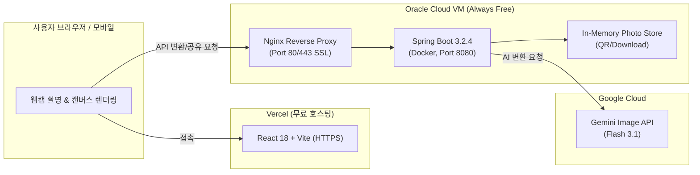

# 🚀 인생네컷 포토부스 배포 가이드 (Vercel + Oracle Cloud Free Tier)

본 프로젝트는 프론트엔드(**Vercel**)와 백엔드(**오라클 클라우드 프리티어 + Docker + SSL**)의 분리 배포 아키텍처로 구성되어 있습니다.



---

## ⚠️ 필수 선행 지식: HTTPS가 필수인 이유
1. **웹캠 접근 권한**: 브라우저 보안 정책상 카메라(`navigator.mediaDevices.getUserMedia`)는 `localhost` 또는 **HTTPS** 환경에서만 작동합니다. Vercel은 기본 HTTPS를 제공합니다.
2. **Mixed Content 차단 방지**: 프론트(HTTPS)에서 백엔드(HTTP)로 API 요청을 보내면 브라우저가 보안 위협으로 차단합니다. 따라서 **백엔드도 반드시 HTTPS**여야 합니다.
3. **도메인이 없는 경우**: 본 가이드에 포함된 **`nip.io` 무료 도메인 기법**(`공인IP.nip.io`)을 통해 별도 도메인 구매 없이 무료로 Let's Encrypt 정식 SSL(HTTPS) 인증서를 발급받을 수 있습니다.

---

## Part 1. 오라클 클라우드 프리티어 백엔드 배포

### 1-1. OCI VM 인스턴스 생성
1. [오라클 클라우드 콘솔](https://cloud.oracle.com/) 로그인
2. **Compute > Instances > Create Instance** 클릭
3. 사양 권장:
   - **OS**: Ubuntu 22.04 LTS (최신)
   - **Shape**:
     - *추천*: Ampere (ARM 2~4 OCPU, 12~24GB RAM) - 평생 무료
     - *또는*: AMD Micro (1 OCPU, 1GB RAM)
4. SSH 키 쌍 저장 후 인스턴스 생성
5. 생성 완료 후 할당된 **공인 IP(Public IP)** 복사 (예: `152.67.123.45`)

### 1-2. OCI 방화벽(수신 규칙) 포트 개방
1. 인스턴스 상세 페이지에서 **Subnet** 클릭 > **Default Security List** 클릭
2. **Add Ingress Rules** (수신 규칙 추가):
   - **Source CIDR**: `0.0.0.0/0`
   - **IP Protocol**: `TCP`
   - **Destination Port Range**: `80, 443, 8080`
   - 규칙 저장

### 1-3. 서버 접속 및 원클릭 환경 구성
SSH를 통해 서버에 접속합니다:
```bash
ssh -i /path/to/your-private-key ubuntu@<공인IP>
```

프로젝트 코드를 클론하거나 업로드합니다:
```bash
git clone <깃허브_저장소_URL>
cd photo4cut
```

초기 환경(도커 및 우분투 방화벽 해제) 스크립트 실행:
```bash
chmod +x setup-oracle.sh setup-ssl.sh
./setup-oracle.sh
```
> 💡 스크립트 실행 후 `exit`로 나갔다가 다시 SSH 접속하면 `sudo` 없이 docker 명령어를 사용할 수 있습니다.

### 1-4. 환경 변수(.env) 설정
```bash
cat << 'EOF' > .env
GEMINI_API_KEY=your_actual_gemini_api_key_here
CORS_ALLOWED_ORIGINS=http://localhost:3000,https://*.vercel.app
APP_PUBLIC_BASE_URL=https://152.67.123.45.nip.io
EOF
```
*(위의 `152.67.123.45` 자리에 본인의 실제 오라클 공인 IP를 입력)*

### 1-5. 원클릭 SSL 발급 및 백엔드 실행
도메인이 없어도 공인 IP 기반 `nip.io` 주소로 즉시 발급됩니다:
```bash
./setup-ssl.sh <공인IP>.nip.io <본인이메일>

# 실행 예시:
# ./setup-ssl.sh 152.67.123.45.nip.io user@gmail.com
```

실행 후 브라우저나 터미널에서 헬스체크 확인:
```bash
curl https://<공인IP>.nip.io/api/v1/photos/health
# 응답: {"service":"AI Photo Booth Service","status":"UP","version":"0.0.1"}
```

---

## Part 2. Vercel 프론트엔드 배포

### 2-1. Vercel 프로젝트 생성
1. [Vercel](https://vercel.com/) 로그인 후 **Add New... > Project** 클릭
2. 본 프로젝트 GitHub 저장소 Import

### 2-2. 배포 설정 (Project Settings)
- **Framework Preset**: `Vite`
- **Root Directory**: `frontend` (반드시 `Edit`을 눌러 `frontend`로 지정)
- **Build Command**: `npm run build`
- **Output Directory**: `dist`
- **Install Command**: `npm install`

### 2-3. 환경 변수 (Environment Variables) 추가
- **Name**: `VITE_API_BASE_URL`
- **Value**: `https://<공인IP>.nip.io` (Part 1에서 설정한 오라클 백엔드 HTTPS 주소)

### 2-4. 배포 (Deploy) 클릭
- 1~2분 내 빌드가 완료되고 `https://your-project.vercel.app` 형태의 도메인이 발급됩니다.

---

## Part 3. 배포 후 최종 점검 체크리스트

| 점검 항목 | 확인 방법 | 정상 동작 기준 |
| :--- | :--- | :--- |
| **카메라 연동** | Vercel 접속 후 2단계 이동 | 브라우저 권한 팝업 승인 후 웹캠 화면 출력 |
| **AI 4컷 변환** | 4장 촬영 후 원하는 컨셉 지정 및 완성 클릭 | 5~15초 내 각 슬롯별 Gemini 변환 이미지 적용 |
| **모바일 QR 다운로드** | 스마트폰 기본 카메라로 화면 QR 스캔 | 브라우저로 백엔드 다운로드 링크 열리며 원본 PNG 다운로드 |
| **프린터 규격 인쇄** | [프린터 인쇄] 모달 확인 | 4x6 / 2x6 포토부스 규격으로 CSS print 렌더링 |

---

## 🛠 문제 해결 (FAQ)

### Q1. Vercel에서 API 요청 시 `Network Error` 또는 `CORS error`가 발생합니다.
- 오라클 서버의 `.env` 파일 내 `CORS_ALLOWED_ORIGINS`에 본인의 Vercel 주소(`https://내앱.vercel.app`)가 포함되어 있는지 확인하세요.
- 기본값으로 `https://*.vercel.app` 와일드카드가 허용되어 있습니다. 수정 후 `docker compose restart backend`를 실행하세요.

### Q2. QR 코드를 스마트폰으로 찍었는데 접속이 안 됩니다.
- 스마트폰과 오라클 서버가 통신 가능한 공인 HTTPS 주소여야 합니다.
- `.env`에 지정된 `APP_PUBLIC_BASE_URL=https://<공인IP>.nip.io` 설정이 정확한지 확인하세요.

### Q3. AI 변환 중 504 Gateway Timeout이 발생합니다.
- Nginx 리버스 프록시 타임아웃이 180초로 넉넉하게 잡혀있는지 확인하세요(`nginx/conf.d/default.conf`의 `proxy_read_timeout 180s`).
- Gemini API 키의 쿼터 및 유효성을 확인하세요.
